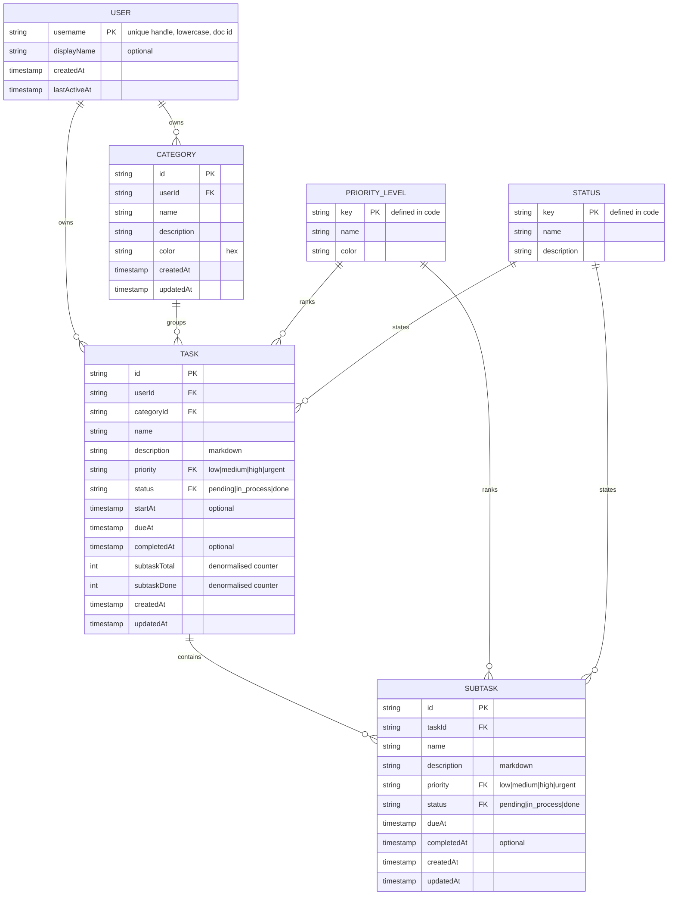

# ToDo — Reviewed ERD

Source: hand-drawn `ToDo_ERD.pdf` (User, Task, Subtask, Category, Priority Level, Status).
Reviewed against the mockups in `ToDo_Mockup/`. This is the **proposed corrected ERD**; Phase 3 of `PLAN.md` turns it into TypeScript types and Firestore paths.

## Original ERD (as drawn)

| Entity | Fields | Relations |
|---|---|---|
| User | Name, User ID | 1 — m Task |
| Task | ID, Name, Priority Level, Due Date, Description, Category, Status | m — 1 Category, m — 1 Priority Level, m — 1 Status, 1 — m Subtask |
| Subtask | ID, Name, Priority, Due Date, Description, Status | belongs to Task |
| Category | ID, Name, Description, Color | 1 — m Task |
| Priority Level | ID, Name, Colour | 1 — m Task |
| Status | ID, Name, Description | 1 — m Task |

## Corrections and why

| # | Problem in the drawn ERD | Correction | Evidence |
|---|---|---|---|
| 1 | Foreign keys are written as the entity name (`Category`, `Status`, `Priority Level`) | Store them as keys: `categoryId`, `status`, `priority` | Standard ERD notation; needed to query |
| 2 | Subtask has no link to its Task | Subtask lives under its Task (`taskId` implied by path, repeated as a field) | `mobile_task`: subtasks listed under a task |
| 3 | Category has no owner, so all usernames would share one category list | Add `userId` ownership (Firestore: sub-collection of the user) | `mobile_categories`: "New Category" is per person |
| 4 | Task cannot show a time range (09:00–10:15) in the Calendar | Add `startAt` (optional) next to `dueAt`; `dueAt` becomes a full date-time, not a date | `mobile_calendar`; `mobile_add_task` uses date + time |
| 5 | Subtask completion time is shown but not stored | Add `completedAt` to Task and Subtask | `mobile_task`: "Completed 10:30 AM" |
| 6 | No audit fields | Add `createdAt`, `updatedAt` to every entity | Needed for ordering, sync and debugging |
| 7 | "Overdue" appears as a selectable status in the mockup, but it is a function of time (`dueAt < now` and not done) | **Store only `pending`, `in_process`, `done`.** Treat `overdue` as a derived state in code | `mobile_task` "Lifecycle state" shows 4 options; storing it goes stale the minute the deadline passes |
| 8 | Progress % (40%, 75%) is shown on every card but not modelled | Derived: `subtasksDone / subtasksTotal`. Store the two counters on Task (`subtaskTotal`, `subtaskDone`) so lists do not need one read per subtask | `mobile_home`, `mobile_category_registry` |
| 9 | Priority and Status are tables with ID/Name/Colour, but their values are fixed | Keep them as **lookup entities defined in code** (`src/constants`), not as Firestore collections. The ERD keeps them so the design is documented | Mockups use fixed sets: Low/Medium/High/Urgent; Pending/In Process/Done/Overdue |
| 10 | "User" has `Name` and `User ID` | `username` is the unique handle and is the Firestore document ID; `displayName` is optional | `mobile_signIn`: "Unique Handle", no password |
| 11 | Subtask has its own Priority but no Category | Keep Priority; Category is **inherited from the parent Task**, not stored | `mobile_add_subtask`: "Inherited from parent" |
| 12 | Priority wording differs between mockups ("Medium" vs "Normal") | Canonical set: `low`, `medium`, `high`, `urgent` | `mobile_add_task` vs `mobile_status` |

## Corrected ERD



## Derived (never stored)

- `overdue` = `status != done` and `dueAt < now`
- `progress` = `subtaskDone / subtaskTotal` (a task with no subtasks is 0% until marked done, then 100%)
- Category task counts and "done ratio" = computed from the category's tasks

## Firestore mapping (decided in Phase 3, built in Phase 4)

```
users/{username}
users/{username}/categories/{categoryId}
users/{username}/tasks/{taskId}
users/{username}/tasks/{taskId}/subtasks/{subtaskId}
```

## Open points for the owner

1. ~~Collaborators~~ **Decided 2026-10-18: no collaboration.** The updated `home`, `calendar`, `mobile_calendar` mockups no longer show assignees; the model has none.
2. ~~Project entity~~ **Decided 2026-10-18: no separate Project entity.** Home cards show the **category name** and the task description where the mockup shows "Website for Rune.io".
3. ~~Attachments~~ **Decided 2026-10-18: no attachments.** The paperclip on `add_task` / `add_subtask` is not built. The description stays a markdown text field.
4. **No authentication means no per-user data protection.** Anyone who knows a username can open that list, and Firestore rules cannot tell callers apart. Accepted for this scope; the rules still enforce the data shape and size.
5. **Fields in the mockups with no ERD field** (not built): sprint / team name, human task code (`TSK-0842`, shown instead as a short id), meeting link ("Google Meet"), PR number, "velocity" and "+1 since yesterday" figures.

Still open: 4 only (accepted risk, default applies). 1, 2, 3 and 5 are settled.
